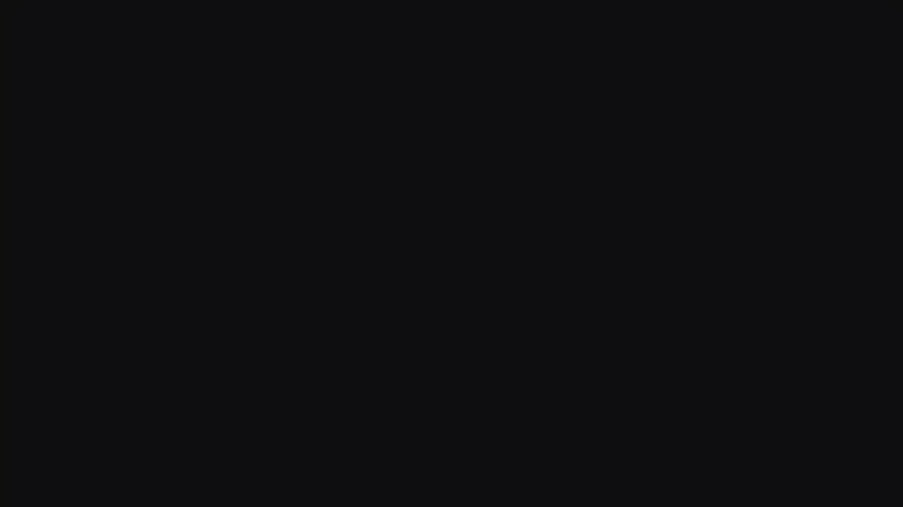

# 🌙 Moonlight 360

[](https://stand-with-ukraine.pp.ua)
[](https://github.com/everythings-gonna-be-alright/moonlight360/releases)
[](https://github.com/everythings-gonna-be-alright/moonlight360/releases)
[](LICENSE)


**Stream your PC games to an Xbox 360.** 🎮 Yes, the 2005 one. Up to **1080p at 60 fps**.

An unofficial [Moonlight](https://moonlight-stream.org) client for RGH/JTAG consoles. It works with
[Sunshine](https://github.com/LizardByte/Sunshine) and its forks (Apollo, Vibeshine), and is built with the
open-source [xsdk](https://github.com/xenosworks/xsdk): no Microsoft XDK involved.



## ✨ Features

- 🏆 **MPEG-2 streaming:** the format the Xbox 360 decodes best. 1080p at 60 fps with the best performance and
  picture. H.264 too.
- 📺 **True 1080p60** on a 1080p TV, not 720p scaled up.
- ⚡ **Low latency:** about 40 ms from PC to TV, and an estimate for the settings you pick.
- 🖱️ **Mouse and keyboard** from the controller, for the PC's desktop and launchers.
- 🔎 **Finds your PC** on the network, wakes it (Wake-on-LAN), shows game covers and your recent games.
- 📊 **Stats HUD:** frame rate, latency, packet loss, CPU and GPU load.
- 🎮 **Made for a TV and a controller,** in two looks: Fresh and Classic.

Not supported: HEVC, AV1 and HDR. The console is older than all three.

## 🚀 Quick start

You need an RGH/JTAG console with a homebrew dashboard (Aurora, FreeStyle Dash or XeXMenu), and a PC running
Sunshine, Apollo or Vibeshine on the same network.

1. **Download** `moonlight360.xex` from
   [Releases](https://github.com/everythings-gonna-be-alright/moonlight360/releases).
2. **Copy** it to a folder on the console, for example `Hdd1:\Apps\Moonlight360\` (FTP or a FAT32 USB stick), and
   launch it.
3. **Find the PC.** On *Play*, press **A** on *Find your PC* and choose it, or type its IP address.
4. **Pair, once.** Pick *Start streaming* and type the 4-digit PIN from the console into the host's web UI
   (`https://localhost:47990` → *PIN*).
5. **Play.** Hold **Back** for a second to open the stream menu (another button or combination can be set in
   *Settings → Controls → Stream menu*).

Settings are saved to `moonlight.ini` next to the `.xex`. If something goes wrong, `moonlight360.log` says why.

## ⚡ Best settings and performance

> [!WARNING]
> **Use a network cable.** Over the console's Wi-Fi a stream can still freeze after a few minutes, and the console
> then receives nothing until it's rebooted. The two known triggers are avoided on Wi-Fi (no rumble to the
> controllers, 20 ms audio packets), yet a stream with both still froze after 5½ minutes, so the cause isn't fully
> found. On a cable it's solid: 1080p at 60 fps and 50 Mbit/s ran 13½ minutes with nothing lost. If Wi-Fi is the
> only option, keep the bitrate at 25 Mbit/s or less, about what the console's Wi-Fi carries.

### Recommended for 1080p: MPEG-2 🏆

**1080p · 60 fps with the MPEG-2 codec: the best performance and image quality.** MPEG-2 is far lighter for the
console to decode than H.264, so nothing has to be left out to keep up.

- **On the PC:** a recent Sunshine, with MPEG-2 on (`mpeg2_mode = 2` in its configuration).
- **On the console:** *Settings* → *Quality*: **1920×1080**, **60 fps**, *Video codec* → **MPEG-2**.
- **On Wi-Fi** keep the bitrate at 25 Mbit/s or less.

### With H.264: a lean stream 🪶

**1080p · 60 fps · 30 Mbit/s, with a lean stream,** for a host without MPEG-2.

- **Measured:** a six-minute stream averaged 59 fps, with 40 ms from the PC to the screen.
- **Trade-off:** the PC's processor does the encoding, and the picture is a little blockier.

### Lean stream setup

A lean stream leaves out the deblocking filter and sub-pixel motion: half of the console's decoding work.

**On the PC** (the host's web UI):

1. *Force a Specific Encoder* → **Software**
2. *Software Encoder* → *SW Presets* → **ultrafast**

**On the console:**

3. **1920×1080**, **60 fps**, *Skip deblocking* off.
4. Start a new stream. The stats HUD shows `CAVLC lean` when it worked.

### No spare CPU on the PC?

Keep the hardware encoder, with *Prefer CAVLC over CABAC* on:

- 720p or 1600×900 at 60 fps
- 1080p at 30 fps, with *Skip deblocking* on

### Decode time per 1080p frame

60 fps needs under 16.7 ms a frame, 30 fps under 33 ms.

| Stream | On the PC | *Skip deblocking* | at 30 fps | at 60 fps |
|---|---|---|---:|---:|
| 🪶 **Lean** | Encoder **Software**, preset **ultrafast** | off | 17 ms | **12 ms** |
| Hardware encoder | *Prefer CAVLC over CABAC* | on | 20 ms | 15 ms |
| Hardware encoder | *Prefer CAVLC over CABAC* | off | 30 ms | 23 ms |

### Under the hood

- FFmpeg decodes on all six hardware threads.
- Its vector code is patched for the 360's CPU (`patches/ffmpeg-xenon-vmx128.patch`).
- Each frame comes as 24 slices, shared between the threads.

## 🛠️ Building

Everything builds in Docker, on Linux or macOS.

```sh
git clone --recursive https://github.com/everythings-gonna-be-alright/moonlight360.git && cd moonlight360
docker build -t moonlight-xsdk-toolchain -f docker/xsdk-toolchain.dockerfile third_party/xsdk/tools/toolchain  # ~10 min, once

run() { docker run --rm -v "$PWD":/work moonlight-xsdk-toolchain /work/$1; }
run scripts/build-xsdk.sh
run scripts/build-ffmpeg.sh
run scripts/build-app.sh      # -> build/app/dist/moonlight360.xex
```

## 🧰 Developer tools (`dev/`)

Not needed to build or use the app.

- **`devlaunch` + `devserver.py`:** send builds to the console over the network and get the logs back.
- **`bench/`:** `decbench`, the console benchmark behind the table above.
- **`vmx_test/`:** checks the 360 vector code against FFmpeg's C code under QEMU, with no console.
- **`menu_preview/`:** renders the menus to PNG on a PC. The screenshots come from it.
- **`make_clips.sh`:** makes the benchmark's test clips.

## 🙏 Credits and license

Built on [moonlight-common-c](https://github.com/moonlight-stream/moonlight-common-c),
[moonlight-tv](https://github.com/mariotaku/moonlight-tv)'s libgamestream, [xsdk](https://github.com/xenosworks/xsdk),
FFmpeg, Opus, mbedTLS, curl and expat. [Free60](https://free60.org) documented the hardware.

GPLv3 (see [LICENSE](LICENSE)); the submodules keep their own licenses. Not affiliated with Microsoft or Moonlight.
Xbox 360 is a trademark of Microsoft.
